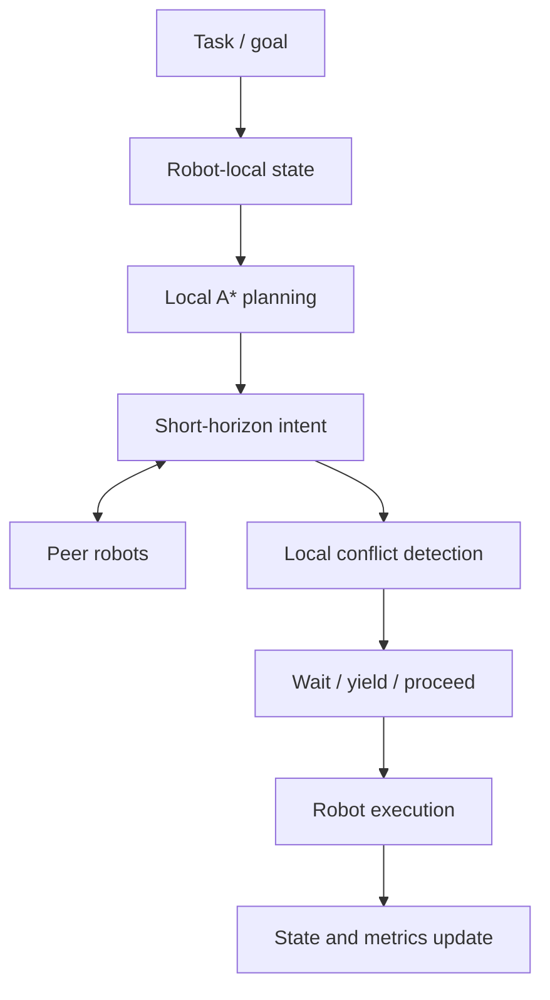

# SYNQ — Decentralized AMR Fleet Coordination

SYNQ is a decentralized multi-robot coordination prototype for autonomous mobile robots (AMRs) in smart warehouses. Robots exchange short-horizon intent and make local conflict decisions without relying on a central traffic controller.

**SIH problem statement:** `SIH26123 — Edge-AI Based Distributed Fleet Coordination for Autonomous Mobile Robots (AMRs) in Smart Warehouses`

> Scope: this prototype tests distributed coordination; it does not contain a machine-learning model. The grid simulator/dashboard and Webots benchmark are separate validation environments. Features in the grid simulator must not be presented as Webots-validated.

## What it demonstrates

- Three Cyberbotics MiR100 robot bodies in Webots R2025a.
- Robot-local planning and peer intent exchange over simulated Webots Emitter/Receiver devices.
- A controlled Stop-and-Wait versus SYNQ comparison.
- A separate grid simulator and FastAPI dashboard for scenario interaction and observability.
- Python tests and repeatable Webots benchmark scripts.

## Architecture



The dashboard controls and observes the grid simulator; it does not choose Webots right-of-way decisions. See [Architecture](docs/ARCHITECTURE.md).

## Quick start (Windows)

Requirements: Python 3.11+ and Git. Install Webots R2025a separately if you want to run the Webots benchmark or visual demo.

```powershell
git clone https://github.com/PhantomCircuit-156/SYNQ-AMR-Fleet-Coordination.git
cd SYNQ-AMR-Fleet-Coordination
py -3.11 -m venv .venv
.\.venv\Scripts\python.exe -m pip install --upgrade pip
.\.venv\Scripts\python.exe -m pip install -e ".[dev]"
```

### Run tests

```powershell
.\.venv\Scripts\python.exe -m pytest -q
```

Run from the repository root and report the result from the current checkout.

### Run the grid simulator/dashboard

```powershell
.\scripts\start_dashboard.bat
```

Alternative:

```powershell
.\.venv\Scripts\python.exe .\scripts\run_dashboard.py
```

Open http://127.0.0.1:8000. Keep the terminal open while using the dashboard; stop it with `Ctrl+C`. The dashboard is separate from the Webots traffic controller.

### Run the Webots benchmark

Install Webots R2025a. From the repository root:

```powershell
& '.\webots\controllers\synq_metrics\run_webots_experiment.ps1' -Mode baseline
& '.\webots\controllers\synq_metrics\run_webots_experiment.ps1' -Mode synq
& '.\webots\controllers\synq_metrics\run_webots_experiment.ps1' -Mode both
```

The runner searches under `%LOCALAPPDATA%\Programs\Webots`. If needed, set `WEBOTS_HOME` to the actual Webots installation directory. Webots supplies its own controller API; it is not a normal pip dependency.

### Run the visual demo

```powershell
& '.\scripts\show_webots_demo.ps1' -Mode synq -Paused
```

Use `-Mode baseline` for the baseline demo. Press Run/real-time in Webots; close and relaunch to change modes. Use the batch runner for measured results and the GUI runner for visual demonstration. See [Visual Demo](docs/VISUAL_DEMO.md).

## Reported Webots benchmark

The repository reports a controlled batch run dated **2026-09-26**. Both modes use the same world, starts, goals, planner, robot model, timestep, and speed limits.

| Metric | Stop-and-Wait | SYNQ |
|---|---:|---:|
| R1 completion | 36.416 s | 36.416 s |
| R2 completion | 61.056 s | 36.416 s |
| R3 completion | 85.696 s | 54.912 s |
| Makespan | 85.696 s | 54.912 s |
| Total waiting | 73.920 s | 18.496 s |
| Conflicts / yields | 2 / 2 | 1 / 1 |
| Safety-threshold breaches | 0 | 0 |

This is a **35.92% makespan reduction in the tested three-AMR scenario**, not a universal performance claim or real-world safety certification. The threshold is centre-to-centre separation below 0.65 m, not a physics-contact count. See [Experiment](docs/EXPERIMENT.md).

## Repository map

| Path | Purpose |
|---|---|
| `coordination/` | Robot-local coordination |
| `planning/` | Path planning |
| `networking/` | Peer messaging |
| `safety/` | Safety policies |
| `tasks/` | Task lifecycle |
| `simulation/` | Grid simulation |
| `dashboard/` | Dashboard application |
| `metrics/` | Metrics and reporting |
| `tests/` | Automated tests |
| `webots/` | Webots worlds and controllers |
| `scripts/` | Launch and experiment scripts |
| `docs/` | Architecture, experiment, demo and limitations |
| `assets/` | Project media and instructions |

## Current limitations

Not yet validated in the Webots prototype: real Wi-Fi, sensor-based localization, SLAM, dynamic obstacle perception, ROS 2 deployment, physical AMR operation, or industrial-scale fleet performance. See [Limitations](docs/LIMITATIONS.md).

## Documentation

- [Getting Started](docs/GETTING_STARTED.md)
- [Architecture](docs/ARCHITECTURE.md)
- [Experiment](docs/EXPERIMENT.md)
- [Visual Demo](docs/VISUAL_DEMO.md)
- [Limitations](docs/LIMITATIONS.md)
- [Asset instructions](assets/README.md)
- [Changelog](CHANGELOG.md)

## License

SYNQ-authored code is offered under the MIT License. Third-party models, libraries and dependencies retain their respective licenses. See [LICENSE](LICENSE).
